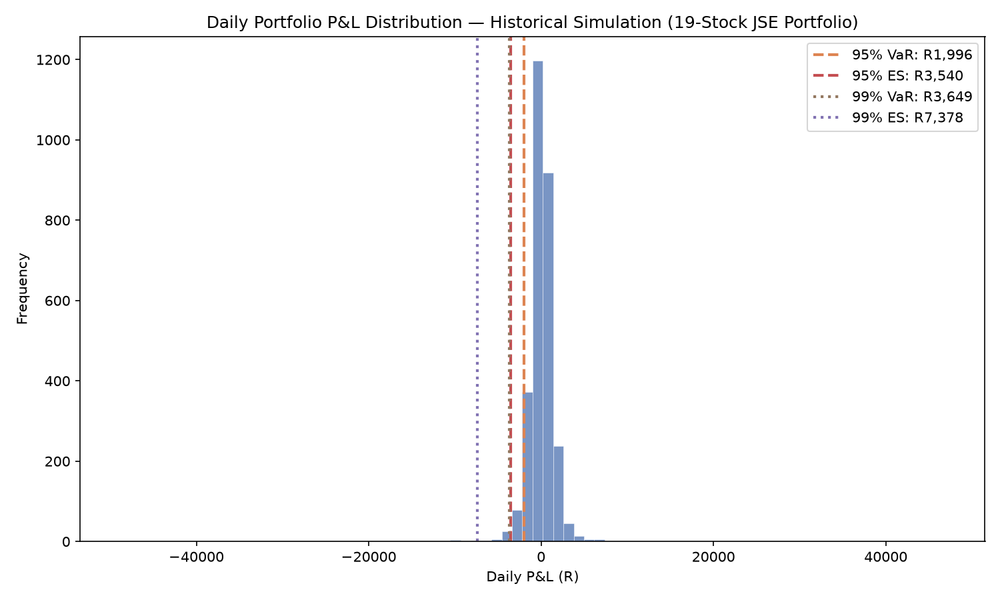

# Portfolio VaR & Expected Shortfall Calculator

A quantitative risk management tool that calculates, cross-validates, and backtests Value at Risk (VaR) and Expected Shortfall (ES) on a JSE equity portfolio using Historical Simulation, Parametric (Variance-Covariance), Monte Carlo and volatility-filtered methods, with historical scenario stress testing. A portfolio monitor then turns the models into something usable: a cost-aware rebalance order list and a 1-day risk report for the portfolio you actually hold.

Built to understand not just *how* these models work, but *where each one breaks down* — including catching a real data-quality issue, showing statistically where one method's assumptions fail, and showing that diversification's value depends on the type of shock a portfolio actually faces.

## Status

- [x] Data pipeline — JSE price fetching via yfinance with a refreshing cache, ticker validation, cents (ZAc) → Rand conversion, price-glitch detection & exact correction, simple return calculation
- [x] Historical Simulation VaR & Expected Shortfall
- [x] Parametric (Variance-Covariance) VaR & Expected Shortfall
- [x] Monte Carlo VaR & ES (Gaussian and Bootstrap variants)
- [x] Return distribution chart with VaR/ES thresholds
- [x] Kupiec Proportion-of-Failures backtesting
- [x] Extended backtesting — window-length sensitivity, EWMA and filtered-historical-simulation models, Christoffersen independence and conditional-coverage tests, ES exceedance test, Basel traffic-light zones
- [x] Historical scenario stress testing (COVID-19, Nenegate)
- [x] Portfolio monitor — holdings in, cost-aware rebalance orders out, 1-day risk report and VaR-limit check

## Portfolio

An equal-weighted basket of 19 JSE Top 40-derived stocks, spanning banking, telecoms, retail, resources, and healthcare:

`NPN.JO, FSR.JO, SBK.JO, MTN.JO, SOL.JO, CPI.JO, VOD.JO, ABG.JO, SLM.JO, DSY.JO, SHP.JO, NED.JO, BVT.JO, APN.JO, GRT.JO, CLS.JO, EXX.JO, WHL.JO, MRP.JO`

**Why 19, not the full Top 40:** three candidates were excluded after a data validation step (`check_ticker_availability()`) revealed Bid Corporation (BID.JO) and Old Mutual (OMU.JO) only have history from 2016/2018 respectively (post spin-off/restructuring), and MultiChoice (MCG.JO) returned no data from Yahoo Finance at all.

## Methodology

**Returns:** Daily *simple* returns (`P_t / P_t-1 - 1`). The portfolio's daily return is the weighted sum of its stocks' simple returns, which is exactly what a portfolio rebalanced daily to target weights earns. Log returns do not aggregate across assets this way: an earlier version that built the portfolio from log returns overstated the 99% ES by about 5% and the COVID stress loss by about 2 percentage points. Log returns are kept only for diagnostics.

**Currency handling:** Yahoo Finance reports JSE equity prices in South African cents (ZAc), not Rand — converted explicitly via `cents_to_rand()`. This has zero effect on returns/volatility (ratios cancel the /100 out); it only matters for displayed price levels and the share-count calculation in the portfolio monitor.

**Data quality — price glitch detection:** Initial analysis showed an implausible excess kurtosis of 274.5, which triggered an investigation (`diagnose_outliers.py`) rather than being reported as a finding. It traced to three single-day price errors (SLM.JO and VOD.JO on 2025-01-10, SBK.JO on 2025-04-25), each a price at 1/100 of its true level — the signature of a cents/Rand unit error at the data source, not a real market move. `detect_price_glitches()` flags a day-over-day move beyond 10x that reverses on the next day, so only the bad day is flagged. `clean_price_glitches()` then rescales that day by 100 (an exact repair, not an interpolation), prints every correction for auditability, and warns if any extreme move remains unresolved. (An earlier version also flagged the correct following day and overwrote it with an interpolated price; this was found in review and fixed.)

**Data refresh:** Prices are cached for 24 hours and then re-downloaded; if a refresh fails, the stale cache is used with a warning. A second warning appears if the newest price is more than 5 business days old. Columns are forced into `TICKERS` order, since yfinance returns them alphabetically and any non-equal weights would otherwise be misassigned.

**Historical Simulation VaR/ES:** Makes no assumption about the shape of the return distribution — uses the empirical distribution of past returns directly.

**Parametric (Variance-Covariance) VaR/ES:** Assumes returns are Normally distributed, characterized by mean and standard deviation alone. Portfolio volatility is verified two independent ways — directly from the combined return series, and via the covariance matrix (`w' Σ w`) — and the two match.

**Monte Carlo VaR/ES:** Two variants. *Gaussian Monte Carlo* simulates 100,000 correlated daily scenarios via Cholesky decomposition of the covariance matrix, cross-checking the Parametric implementation. *Bootstrap Monte Carlo* resamples actual historical days with replacement, cross-checking the Historical implementation.

**Kupiec Proportion-of-Failures backtesting (`backtest.py`):** Rather than comparing methods only to each other, this tests whether each method's VaR would have held up against real outcomes. It uses a rolling 250-trading-day window — VaR on any given day is estimated ONLY from the preceding 250 days, never from future data, avoiding the look-ahead bias of testing a model on the sample it was fit on. It counts "breaches" (days where the actual loss exceeded the VaR threshold) and tests via the Kupiec likelihood-ratio statistic whether the observed breach rate is statistically consistent with the model's stated confidence level.

**Extended backtesting (`backtest_extended.py`):** Adds five things on top of Kupiec.
- *Window sensitivity:* repeats the Historical and Parametric tests with 125-, 250-, 500- and 750-day windows.
- *Time-varying volatility:* two further models. **EWMA-Normal** uses a Normal distribution with an exponentially weighted volatility (RiskMetrics, λ = 0.94). **EWMA-FHS** (filtered historical simulation) divides each past return by the volatility forecast for its own day, takes the empirical quantile of those standardised returns, and rescales it by today's volatility forecast, so it reacts to volatility regimes while keeping the real fat tails.
- *Christoffersen tests:* Kupiec only counts breaches; the independence test asks whether breaches cluster in time, and conditional coverage combines both.
- *ES exceedance test (McNeil–Frey style):* on breach days, the realised loss minus the predicted ES, scaled by the rolling standard deviation, is tested for a zero mean against the alternative that it is positive (ES too low).
- *Basel traffic light:* 99% VaR breach counts over rolling 250-day windows, classed green (0–4), yellow (5–9) or red (10+).

All four models are compared on the same 2,675 days (2016-03-11 to 2026-10-30), which start 60 days later than `backtest.py` because EWMA needs a burn-in. No forecast uses data from its own day or later.

**Historical scenario stress testing:** Re-applies actual historical crisis returns to the current portfolio composition and weights, compounding the daily portfolio returns (`prod(1 + r) - 1`, consistent with daily rebalancing) — answering "if this exact event happened again today, what would we lose?"

## Key findings

*Figures are from the 30 October 2026 run (2,986 trading days from 1 January 2015, R100,000 portfolio) and shift slightly as the data refreshes. In the test tables, \* marks rejection at the 5% level.*

**1. A data-quality bug initially made tail risk look far more extreme than it was.** Before cleaning, excess kurtosis measured 274.5 — implausible for a diversified 19-stock equity portfolio. Investigating rather than reporting this number traced it to three single-day cents/Rand unit errors in 2025. After correction, excess kurtosis fell to a realistic **5.72** and annualized volatility is **20.78%**. Verifying data quality before trusting a risk number is not optional in this field.

**2. Real fat tails persist after cleaning, and the Normal model's error changes sign with the confidence level.**

| Metric | Historical | Parametric (Normal) | Gap |
|---|---|---|---|
| 95% VaR | R1,929.27 | R2,116.46 | -8.8% |
| 95% ES | R2,951.59 | R2,663.40 | **+10.8%** |
| 99% VaR | R3,393.38 | R3,008.47 | +12.8% |
| 99% ES | R4,959.32 | R3,452.01 | **+43.7%** |

(Gap = Historical ÷ Parametric − 1, both as Rand losses. Positive means the Normal model understates the real loss.) Against a Normal curve with the same standard deviation, a fat-tailed distribution has fewer moderate bad days and more extreme ones, so the Normal model overstates the 95% VaR but understates the 99% VaR and the ES, which averages the most extreme days. Expected Shortfall exposes the fat tails more clearly than VaR does.

**3. The cross-checks validate the implementations.** There are two modelling families here (Normal-assumption and empirical), each implemented twice. Gaussian Monte Carlo matched Parametric within 0.12% on VaR (0.65% on 99% ES); Bootstrap Monte Carlo matched Historical within 0.73% on VaR (up to 2.3% on 99% ES, as expected from sampling noise in the extreme tail). The ~13%/~44% gap between the two families persisted, so the fat-tail effect is a property of the data, not a calculation quirk.

**4. Kupiec backtest (rolling 250 days, 2,735 out-of-sample days).** Historical VaR was not rejected at either confidence level (95%: 149 breaches vs 136.8 expected, p = 0.29; 99%: 32 vs 27.4, p = 0.38). Parametric VaR passed at 95% (127 breaches, p = 0.39) but was **rejected at 99% (42 breaches vs 27.4 expected, about 53% more than its stated confidence implies, p = 0.0091)**. 99% VaR is the long-standing Basel market-risk standard (the newer FRTB framework moves the capital measure to 97.5% ES), so this is the tail that matters for capital.

**5. The Parametric result is consistent but fragile to how it is tested.** Across window lengths, Parametric 99% VaR has more breaches than expected every time, but the Kupiec test only rejects it at some windows:

| Window | 99% expected | Historical (p) | Parametric (p) |
|---|---|---|---|
| 125 days | 28.6 | 52 (0.000\*) | 51 (0.000\*) |
| 250 days | 27.4 | 32 (0.384) | 42 (0.009\*) |
| 500 days | 24.9 | 27 (0.669) | 32 (0.168) |
| 750 days | 22.4 | 24 (0.729) | 28 (0.248) |

On the shared 2,675-day sample used for model comparison, Parametric 99% scores 37 breaches against 26.8 expected (p = 0.060). The honest summary is persistent under-coverage at 99%, not a single decisive p-value. At 95%, long windows make the Normal model too cautious instead (750 days: 82 breaches vs 111.8 expected, p = 0.002\*), while Historical with only 125 days has too few tail observations (about one or two at 99%) and fails at both levels.

**6. Passing Kupiec is not enough: breaches cluster and ES is too low.** At 99% on the shared sample:

| Method | Breaches (exp. 26.8) | Kupiec p | Independence p | Cond. coverage p | ES test p | Realised ÷ predicted ES |
|---|---|---|---|---|---|---|
| Historical | 30 | 0.536 | 0.004\* | 0.013\* | 0.013\* | 1.14 |
| Parametric | 37 | 0.060 | 0.001\* | 0.001\* | 0.000\* | 1.31 |
| EWMA-Normal | 46 | 0.001\* | 0.008\* | 0.000\* | 0.002\* | 1.12 |
| EWMA-FHS | 35 | 0.126 | 0.086 | 0.071 | 0.370 | 1.01 |

Historical VaR has about the right number of breaches, but they bunch together in volatile periods, and its ES understates the average breach-day loss by 14%. Parametric understates it by 31% at 99% and by 16% at 95% (95% ES test p < 0.001, even though its 95% VaR passes Kupiec).

**7. Time-varying volatility helps only when paired with empirical tails.** EWMA-Normal reacts to volatility but still assumes Normal tails, and it was the worst model at 99% (46 breaches against 26.8). EWMA-FHS, which combines the faster volatility forecast with the empirical shape of the tails, was the only model not rejected on any test at 99%, and its ES matched realised losses almost exactly (ratio 1.01). At 95%, Historical and EWMA-FHS both passed every test (EWMA-FHS ES ratio 1.01; Historical 1.03), while the two Normal-based models had ES rejected (p < 0.001). Caveats: with about 27 expected breaches the tests have limited power, EWMA-FHS's independence and conditional-coverage p-values (0.086, 0.071) sit not far above 0.05, λ = 0.94 was not tuned, and the four models were compared on the same sample with no separate validation period, so this is "best of four on this history", not a proof of future performance.

**8. Basel traffic light (99% VaR, rolling 250-day breach counts).**

| Method | Latest 250 days | Worst 250 days | % green | % yellow | % red |
|---|---|---|---|---|---|
| Historical | 1 (green) | 8 | 79% | 21% | 0% |
| Parametric | 2 (green) | 11 | 72% | 19% | 9% |
| EWMA-Normal | 2 (green) | 10 | 55% | 44% | 1% |
| EWMA-FHS | 2 (green) | 7 | 75% | 25% | 0% |

All four models are in the green zone for the most recent year. Over the full history only Parametric (and, briefly, EWMA-Normal) reached the red zone, which in a regulatory setting would trigger a capital add-on.

## Stress Testing

Rather than asking "what could happen" or "what does the model predict," stress testing re-applies actual historical crisis returns to the current portfolio: "if this exact event happened again today, what would we lose?" Two scenarios were chosen deliberately — one global, one South Africa-specific — since a JSE portfolio faces both.

**COVID-19 Crash (Feb 20 – Mar 23, 2020):** -41.53% cumulative loss over 23 trading days (R41,534 on R100,000). Every one of the 19 holdings fell on the worst single day (Mar 23; portfolio -9.13%, R9,135), led by Sasol (-19.4%) and MTN (-17.9%). A textbook systemic shock — diversification within a single market offers little protection when the whole market moves together.

**Nenegate (Dec 8–11, 2015):** -11.17% cumulative loss over just 4 trading days (R11,171). On the worst day (Dec 10; portfolio -6.80%), every major bank was hit hard (FirstRand -14.8%, Absa -14.5%, Standard Bank -13.5%, Nedbank -10.6%) — but Sasol *gained* +8.5% and Naspers +2.4%. Both earn substantial revenue outside South Africa, so a rand collapse triggered by political crisis acts as a currency tailwind for them, even as rand-funded banks were crushed by the same event. A real, explainable natural hedge inside the portfolio.

**Key insight:** the two scenarios reveal fundamentally different risk structures. Global systemic shocks (COVID) move every holding in the same direction — little diversification benefit exists, consistent with tail risk surviving diversification. Local political/currency shocks (Nenegate) show genuine within-portfolio dispersion, where sector composition itself provides a hedge. Diversification's value is shock-dependent, not universal.

## Portfolio monitor (live-use layer)

`portfolio_monitor.py` turns the risk models into something that can be acted on. It does **not** place orders: it prints a list to place manually with live prices from your broker.

- **Holdings in:** reads `private/holdings.csv` (columns `ticker,units`, plus an optional `CASH` row), or assumes a cash amount to invest from scratch with `--capital`.
- **Rebalance orders out:** compares current weights with the target (equal) weights and trades only on a first investment or when any weight drifts more than 2 percentage points from target, since every trade costs money. Units are rounded down so planned spending never exceeds available cash. Fractional units are the default; `--whole-shares` rounds to whole shares and spends leftover cash on the most under-weight stock it can still afford.
- **Costs:** estimated brokerage (0.25%, 1c minimum) plus securities transfer tax (0.25%, on purchases only), deducted *before* sizing the trades. Other levies and platform fees are not included, and every rate is a named constant in the file to verify against your broker's current cost profile.
- **Risk report:** 1-day VaR and ES at 95% and 99% for the portfolio held after the trades, using Historical Simulation and EWMA-FHS (which reflects the current volatility regime), checked against a VaR limit using the larger of the two 99% VaRs.
- **Privacy:** holdings and the order list live in `private/`, which is git-ignored.

Example: a first investment of R5,000 using the closing prices of 30 October 2026.

```text
Portfolio value now: R5,000.00   (stocks R0.00, cash R5,000.00)
REBALANCE TRIGGERED (first investment).

Ticker Price (R) Units now Trade units Trade (R) Cost (R) Weight after Action
NPN.JO    678.60    0.0000     +0.3858   +261.80     1.31        5.26%    BUY
CPI.JO  4,610.50    0.0000     +0.0567   +261.42     1.31        5.25%    BUY
GRT.JO     15.55    0.0000    +16.8391   +261.85     1.31        5.26%    BUY
... (19 positions in total)

Buys R4,974.50 | Sells R0.00 | Estimated costs R24.87 (0.50% of portfolio) | Cash left R0.63

                          Historical    EWMA-FHS (now)
99% VaR                      R168.80            R90.31
99% Expected Shortfall       R246.70           R128.65
Forecast volatility tomorrow (annualised): 13.0%

Limit check: larger of the two 99% VaRs = R168.80 (3.39% of value) vs limit R199.01 (4.0%) -> WITHIN LIMIT
```

How to read it: getting invested costs about 0.5% (R24.87) before any return is earned. The historical 99% VaR is about 3.4% of value, while EWMA-FHS gives about half that because forecast volatility (13.0% annualised) is well below the long-run 20.8%, which is why the limit check takes the larger figure. A single CPI.JO share costs over R4,600, so equal weights at this size are only practical with fractional shares. VaR describes a bad day, not a worst case: the COVID stress test above lost about 41%.

## Visualization



## Setup

```powershell
git clone https://github.com/HleloMankosi/var-es-calculator.git
cd var-es-calculator
python -m venv venv
.\venv\Scripts\Activate.ps1
pip install -r requirements.txt
```

## Usage

```powershell
python src/data_loader.py        # fetch/cache price data, detect/clean glitches, print return stats
python src/var_historical.py     # compute Historical VaR & Expected Shortfall
python src/var_parametric.py     # compute Parametric VaR & ES, compare against Historical
python src/var_monte_carlo.py    # compute Monte Carlo VaR & ES (Gaussian + Bootstrap), cross-validate
python src/backtest.py           # Kupiec POF backtesting: rolling-window validation against real outcomes
python src/backtest_extended.py  # window sensitivity, EWMA/FHS models, Christoffersen, ES test, Basel zones
python src/stress_test.py        # historical stress scenarios: COVID-19 crash, Nenegate
python src/visualize.py          # generate the P&L distribution chart
python src/diagnose_outliers.py  # investigate extreme single-day returns (uncleaned data)
python src/portfolio_monitor.py --capital 5000  # rebalance order list + 1-day risk report (add --whole-shares for whole units)
```

## Known limitations

- The VaR/ES models assume daily rebalancing to fixed equal weights with no transaction costs; the portfolio monitor instead rebalances on a 2-percentage-point drift band and models brokerage and securities transfer tax, so live results will differ from the backtests
- Survivorship bias: the 19 holdings are today's survivors with full history since 2015, so any return statistic from this history is flattered
- All 19 holdings are JSE equities — no cross-asset-class diversification (bonds, offshore exposure)
- Historical VaR is bounded by the 2015–present sample window
- The model comparison uses one sample for both comparing and judging models, with no separate validation period; EWMA's λ = 0.94 is the RiskMetrics default and was not tuned
- At 99%, only about 27 breaches are expected, so every backtest has limited statistical power, and the ES test is a simple exceedance test, not a full ES validation framework
- 99% ES rests on about 30 tail observations and is reported without confidence intervals
- GARCH-family models have not been fitted; EWMA is the simpler time-varying-volatility benchmark
- Monte Carlo here is largely a validation exercise; it becomes essential once a portfolio includes non-linear instruments (options, etc.)
- Stress scenarios apply today's weights to past returns: a hypothetical "if held today" test, not a literal historical reconstruction
- Price data comes from Yahoo Finance via yfinance, an unofficial source
- The monitor sizes trades from the last close, not live quotes; its cost estimates exclude other regulatory levies, platform fees, dividend withholding tax and capital gains tax
- The 4% VaR limit is a placeholder, not a recommendation, and target weights are simply equal
- The monitor has not been validated against a live trading record; it should be paper traded before real money is used. This project is not financial advice

## Roadmap

- Paper-trading log: record each week's recommended orders and holdings, and compare with actual prices
- Bootstrap confidence intervals for VaR/ES
- GARCH-family volatility (e.g. GJR-GARCH with Student-t errors) as a further comparison
- Re-measure the 5-stock vs 19-stock diversification effect on cleaned data
- A diversifying asset (bond, money-market or offshore ETF) and risk-optimized weights
- Scheduled weekly report and alerting when the VaR limit is breached
- Additional stress scenarios (e.g. 2018 EM selloff, load-shedding-driven periods)